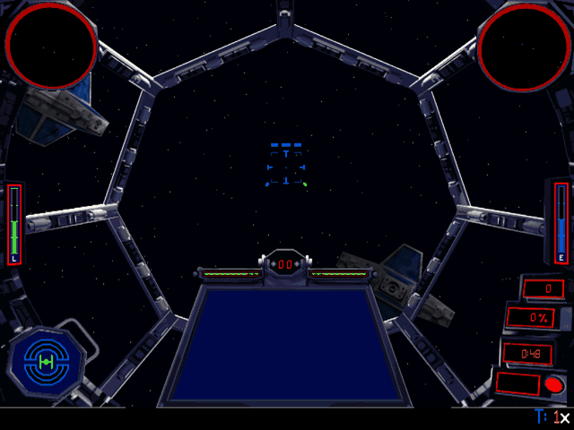
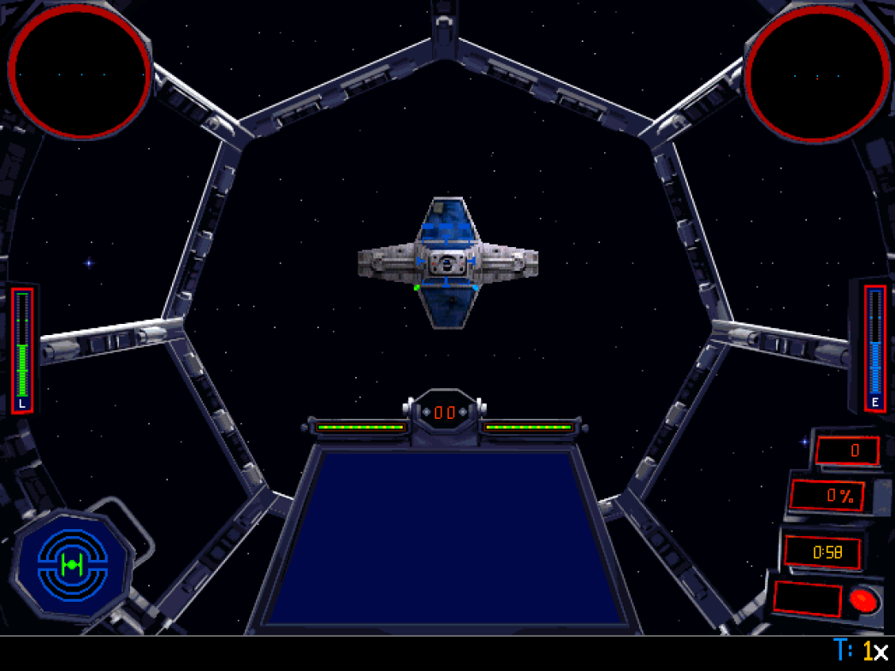
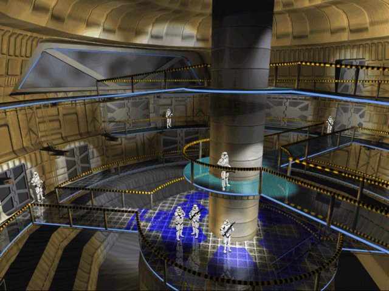
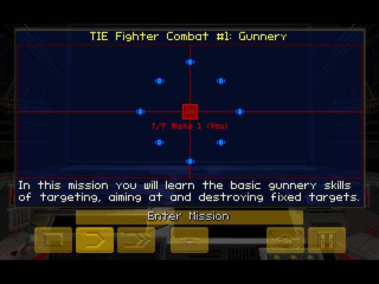
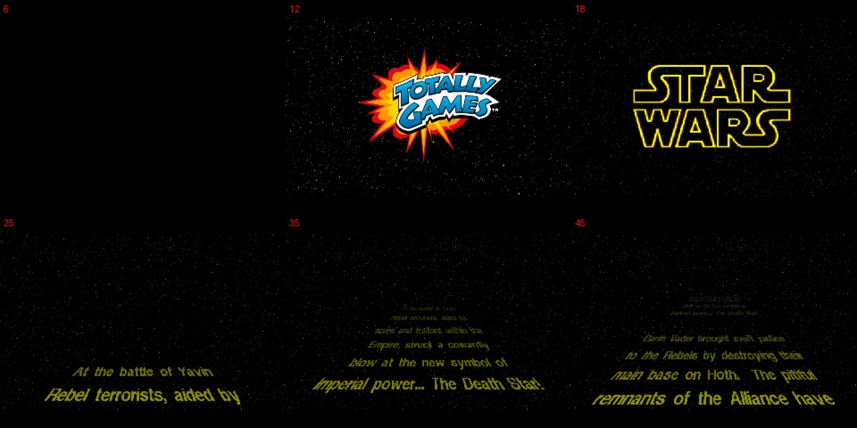

# TIE Fighter recomp

A static recompilation of **Star Wars: TIE Fighter** (the 1998 Windows 95
edition, as sold on Steam) to a native 32-bit Windows program, with the same
remaster as the [X-Wing recomp](https://github.com/sp00nznet/xwing-recomp),
which this is a fork of: the two games share an engine. The game's x86 code is
lifted to C by pcrecomp and runs on its native32 runtime.



You supply your own copy of the game. Nothing from it is in this repo.

## Status

**Alpha.** Flies. Boots, plays the intro, registers a pilot, walks the
Imperial concourse, plays the Combat Chamber briefing and flies mission 1
(TIE Fighter Combat #1: Gunnery) in the TIE cockpit, in the game's Direct3D
mode drawn at the window's resolution. Sound plays.






## The remaster

As X-Wing's (see its README): a Direct3D 11 window (F11 fullscreen, F12
scaling, F10 settings, kept in `build\tie.ini`), the game's 3D hardware mode at
the window's resolution, HD texture replacement (`mods\textures`), mod files
(`mods\files`), and flying with a pad, the mouse or the arrow keys.

## Step by step

1. Copy the Steam folder `STAR WARS Tie Fighter/remastered` into `game/`.
2. Unwrap the SteamStub DRM from your copy with
   [Steamless](https://github.com/atom0s/Steamless) and put the result at
   `work/tie95.exe`:
   ```
   Steamless.CLI.exe game\TIE95.EXE
   copy game\TIE95.EXE.unpacked.exe work\tie95.exe
   ```
3. Catalogue and lift it:
   ```
   py -3 ..\pcrecomp\tools\disasm\disasm32.py work\tie95.exe -o work\functions.json
   py -3 run_lift.py --all
   ```
4. Build: `build.cmd` (Visual Studio 2022, x86 tools).
5. Run: `build\tierecomp.exe --run`

## How it differs from the original

Everything in X-Wing's table, and:

| What | Why |
|---|---|
| The developers' debug print (`sub_00416080`) returns at once | it writes text into the monochrome adapter's memory at 0xB0000, which on Windows is the system's |
| Icons and cursors from the game's executable on disk | read from the mapped image they fault |

The test switches are X-Wing's (`--keys`, `--shot`, `--watchdog`, `--sound-log`).
